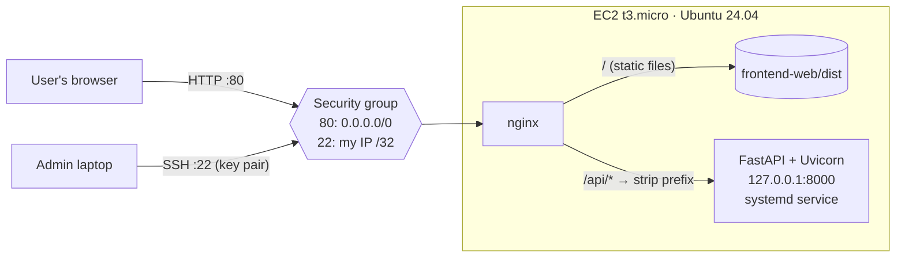

# WordleBot on AWS EC2

A full-stack Wordle solver (React + FastAPI) deployed on a **single Amazon EC2 instance**, built for an AWS and Cloud Computing course. The goal was to host a real web application on EC2 by hand — launch, secure, deploy, operate — while keeping the AWS bill close to **$0**.

| | |
|---|---|
| **Cloud** | AWS EC2 only (no other paid services) |
| **Region** | `ap-south-1` (Mumbai) |
| **Instance** | `t3.micro`, Ubuntu 24.04 LTS, 10 GB gp3 EBS |
| **Web server** | nginx (static frontend + reverse proxy) |
| **Backend** | Python 3.12, FastAPI, Uvicorn, managed by systemd |
| **Frontend** | React 19 + TypeScript + Vite |
| **Total AWS cost** | effectively $0 (verified in Cost Explorer) |

---

## Architecture



- **One public entry point.** nginx listens on port 80, serves the built React app, and forwards `/api/*` to the backend.
- **Backend is private.** Uvicorn binds to `127.0.0.1:8000`, so it is reachable only through nginx, never directly from the internet.
- **Self-healing.** `nginx` and `wordlebot-backend` are systemd services enabled at boot and restarted on failure, so the app comes back automatically after a stop/start or reboot.

## AWS resources

Only three resources are created, all in the default VPC:

| Resource | Configuration | Reason |
|---|---|---|
| EC2 instance | `t3.micro`, official Canonical Ubuntu 24.04 AMI | Smallest burstable type that runs the app; free-tier eligible |
| EBS volume | 10 GB `gp3`, delete on termination | Cheaper than gp2; no orphaned volumes |
| Security group `wordlebot-sg` | Inbound 80 from `0.0.0.0/0`, 22 from admin IP `/32` | Public website, least-privilege admin access |
| Key pair `wordlebot-key` | Private key stays on the admin machine | Key-based SSH, no passwords |
| Networking | Default VPC, default public subnet, auto-assigned public IP | No extra resources or cost |

## Deploying

Prerequisites: AWS CLI v2 configured (`aws configure`), Bash (Git Bash works on Windows), `ssh`/`scp`.

```bash
cd deploy/ec2/scripts

# 1. Create key pair, security group and instance (prints INSTANCE_ID, SG_ID, PUBLIC_IP)
./01-launch-ec2.sh

# 2. Copy the code with scp, install Python/Node/nginx, build, and start services
./02-deploy.sh <PUBLIC_IP>
```

Then open `http://<PUBLIC_IP>/`. Re-running `02-deploy.sh` pushes code updates.

What `setup-server.sh` does on the instance:

1. `apt install` Python venv, nginx; Node.js 22 from NodeSource
2. Creates `backend/.venv` and installs `requirements.txt`
3. Builds the frontend with `VITE_API_BASE_URL=/api`
4. Installs [`wordlebot-backend.service`](deploy/ec2/systemd/wordlebot-backend.service) and the [nginx site](deploy/ec2/nginx/wordlebot.conf)
5. `chmod o+x /home/ubuntu` so nginx can read the built files (fixes a 500 error caused by Ubuntu's default 750 home permissions)

### Manual equivalent (AWS Console)

1. **EC2 → Launch instance:** Ubuntu 24.04, `t3.micro`, new key pair, 10 GB gp3.
2. **Network settings:** allow SSH from *My IP* and HTTP from *Anywhere*.
3. `scp` the code, SSH in, and run [`setup-server.sh`](deploy/ec2/scripts/setup-server.sh).

## Operating and cost control

```bash
./instance.sh status        <INSTANCE_ID>
./instance.sh start         <INSTANCE_ID>          # prints the NEW public IP
./instance.sh stop          <INSTANCE_ID>          # stop when not in use
./instance.sh update-ssh-ip <INSTANCE_ID> <SG_ID>  # after your home IP changes
```

| State | Cost |
|---|---|
| Running `t3.micro` (ap-south-1) | ~$0.0104 / hour (~$7.6 / month if left on) |
| Stopped | $0 compute; ~$0.08 / month for the 10 GB gp3 volume |
| Terminated | $0 — but everything is deleted |

The instance is **stopped, not terminated**, between uses. Cost Explorer (`aws ce get-cost-and-usage`) showed the total spend for this project as effectively **$0**.

## Security

- SSH restricted to a single `/32` admin IP; key-pair authentication only.
- Backend never exposed publicly (bound to localhost, reached via nginx).
- Only ports 80 and 22 open; security groups are stateful, so no outbound rules are needed for responses.
- No secrets in the repository; the `.pem` key is never committed (`.gitignore`).

## The application

You enter each guess and set the tiles to match Wordle's colours; the backend suggests the best next word.

The solver ([`backend/services/solver.py`](backend/services/solver.py)) follows the approach of [ybenhayun/wordlebot](https://github.com/ybenhayun/wordlebot):

- Possible answers come from the official 2,309-word answer list; any of the 12,972 valid words may be guessed.
- Guesses are shortlisted with a bucket-size heuristic, then the top 50 are scored by playing every remaining answer to the end of the game.
- Every guess/answer colour pattern is **precomputed with NumPy at startup**, so each request is array lookups instead of millions of Python calls.

| Metric | Result |
|---|---|
| Average guesses (all 2,309 answers, opener SALET) | **3.42** |
| Games not solved in 6 | **0** |
| Slowest API response on t3.micro | under 1 s (was 21.6 s before precomputation) |

### API

| Method | Path (via nginx) | Body | Response |
|---|---|---|---|
| GET | `/api/health` | — | `{"status": "ok"}` |
| POST | `/api/wordle/next-guess` | `{"guesses": ["salet"], "feedbacks": ["gbbbg"]}` | `{"guess": "..."}` |

Feedback letters: `g` = green, `y` = yellow, `b` = grey.

## Lessons learned

1. **Public IPs change on every start.** An Elastic IP or a domain name would give a stable address (an Elastic IP is only free while attached to a running instance, so it was skipped to keep cost at $0).
2. **Phones may try HTTPS first.** With port 443 closed the page hangs; the real fix is a domain plus a free TLS certificate.
3. **Do heavy work once at startup on small instances.** Precomputing the solver's pattern table cut the worst response from 21.6 s to under 1 s and saves t3 CPU credits.
4. **Read the nginx error log first** — it pinpointed the home-directory permission problem immediately.

## Future improvements

- HTTPS with a domain (Route 53) and a free TLS certificate
- Elastic IP for a stable address
- CloudWatch alarms for CPU credits and a health check
- Provision with a user-data script or CloudFormation/Terraform
- Auto Scaling group behind an Application Load Balancer (the backend is stateless)

## Repository structure

```
backend/                 FastAPI app
  api/wordle.py          /wordle/next-guess endpoint
  services/solver.py     solver
  data/                  answer list (2,309) and valid guesses (12,972)
frontend-web/            React + Vite frontend
deploy/ec2/
  scripts/               01-launch-ec2.sh, 02-deploy.sh, setup-server.sh, instance.sh
  nginx/wordlebot.conf   nginx site (static + /api proxy)
  systemd/               wordlebot-backend.service
docs/
  Project_Report.pdf     course report
  WordleBot_AWS_Video_Script.pdf
```

## Running locally

```bash
# Backend
cd backend
python -m venv .venv && source .venv/bin/activate   # Windows: .venv\Scripts\activate
pip install -r requirements.txt
uvicorn main:app --port 8000

# Frontend (new terminal)
cd frontend-web
echo "VITE_API_BASE_URL=http://127.0.0.1:8000" > .env.local
npm install && npm run dev
```

## Author

Diya Bhagavati Alla and Shubhashree D — AWS and Cloud Computing course project, 2026.
