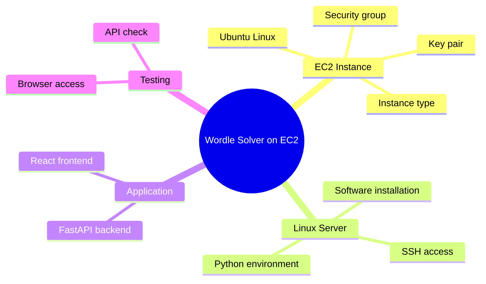
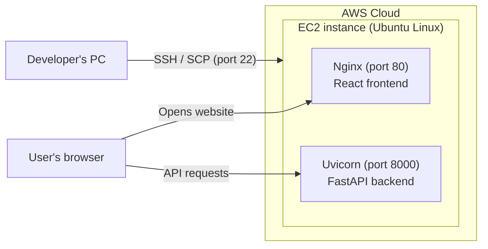
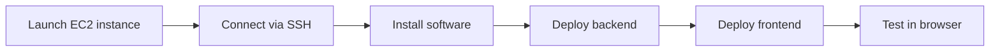

# Setting Up an AWS EC2 Instance and Linux Server to Host a Web Application

**Project:** Wordle Solver (FastAPI backend + React web frontend)\
**Course:** AWS and Cloud Computing\
**Submitted by:** Diya Bhagavati Alla and Shubhashree D\
**Date:** September 2026

---

## Abstract

This project will set up an Amazon EC2 instance running Ubuntu Linux and use it to host a web application called Wordle Solver. The application has a Python FastAPI backend that suggests the next best Wordle guess and a React frontend that runs in the browser. The project will cover launching the EC2 instance, connecting to it over SSH, installing the required software on the Linux server, and deploying both parts of the application so it can be reached from a browser over the internet.

## 1. Introduction

Cloud computing lets users rent computing resources on demand and pay only for what they use [1]. Amazon Web Services (AWS) provides virtual servers through **Amazon Elastic Compute Cloud (EC2)**. An EC2 instance is a virtual machine in the AWS cloud that can run an operating system such as Linux and be managed remotely, just like a physical server [2].

In this project, a single EC2 instance running Ubuntu Linux will act as the server for the Wordle Solver application. The backend will run on the instance, and the frontend will be served to users' browsers from the same instance. This shows how a simple web application can be hosted in the cloud without owning any physical hardware.

## 2. Objectives

1. Launch an EC2 instance with an Ubuntu Linux image.
2. Connect to the instance securely using SSH and a key pair.
3. Install the required software on the Linux server.
4. Deploy the FastAPI backend and the React frontend on the instance.
5. Access and test the application from a web browser using the instance's public IP address.

## 3. System Architecture and Ideation Map

### 3.1 Ideation Map



*Figure 1: Ideation map of the project.*

### 3.2 System Architecture



*Figure 2: System architecture.*

The EC2 instance runs two parts of the application:

| Part | Technology | Port | Role |
| --- | --- | --- | --- |
| Frontend | React, served by Nginx | 80 | Web page the user interacts with |
| Backend | FastAPI, run with Uvicorn | 8000 | Receives guesses and returns the next suggested word |

The user opens the website from the instance's public IP address. The page then sends API requests to the backend on port 8000 of the same instance. The developer manages the server over SSH.

## 4. Module Implementation



*Figure 3: Implementation steps.*

### Module 1: Launching the EC2 Instance

The instance will be created from the AWS Management Console (*EC2 → Launch instance*) with these settings:

| Setting | Value |
| --- | --- |
| AMI (operating system) | Ubuntu Server (LTS) |
| Instance type | t2.micro (free tier eligible) |
| Key pair | New key pair, downloaded as a `.pem` file |
| Storage | Default |

The security group acts as the instance's firewall [4]. The following inbound rules will be added:

| Type | Port | Source | Purpose |
| --- | --- | --- | --- |
| SSH | 22 | My IP | Connect to the server |
| HTTP | 80 | Anywhere | Open the website |
| Custom TCP | 8000 | Anywhere | Backend API |

### Module 2: Connecting to the Linux Server

After the instance starts, its public IP address is shown in the console. The server is accessed over SSH using the downloaded key pair [3][5]:

```bash
ssh -i wordlebot-key.pem ubuntu@<public-ip>
```

### Module 3: Installing Software

The Linux server's packages are updated, and Python and Nginx are installed:

```bash
sudo apt update && sudo apt upgrade -y
sudo apt install -y python3-venv nginx
```

### Module 4: Deploying the Backend

The backend code is copied to the server with `scp`. Its dependencies are installed in a Python virtual environment, and the API is started on port 8000:

```bash
cd backend
python3 -m venv .venv
.venv/bin/pip install -r requirements.txt
nohup .venv/bin/uvicorn main:app --host 0.0.0.0 --port 8000 &
```

### Module 5: Deploying the Frontend

The React frontend is built with the backend address set to `http://<public-ip>:8000`. The build output is copied to the server and placed in Nginx's web folder:

```bash
sudo cp -r dist/* /var/www/html/
```

### Module 6: Testing

The backend is checked by opening `http://<public-ip>:8000/health`, and the website by opening `http://<public-ip>/` in a browser.

## 5. Results and Discussion

### 5.1 Expected Results

| # | Test | Expected result |
| --- | --- | --- |
| 1 | Instance status in the EC2 console | Instance is running and status checks pass |
| 2 | SSH connection | Logged in to the Ubuntu server |
| 3 | Open `http://<public-ip>:8000/health` | Returns `{"status":"ok"}` |
| 4 | Open `http://<public-ip>/` | Wordle Solver page loads |
| 5 | Enter a guess and request a suggestion | Next suggested word is displayed |

### 5.2 Discussion

- **Full control:** EC2 gives complete access to the Linux server, so any software can be installed and configured as needed.
- **Low cost:** a t2.micro instance is eligible for the AWS free tier, which suits small projects and learning.
- **Security:** the security group allows only the ports the application needs, and SSH login requires the private key file.
- **Limitations:** the public IP address changes if the instance is stopped and started again, the backend has to be restarted manually after a reboot, and the site uses plain HTTP.

## 6. Conclusion

This project will show how to launch an EC2 instance, set up an Ubuntu Linux server, and host a full-stack web application on it. With one virtual server, the Wordle Solver becomes reachable from anywhere through a browser. It demonstrates the basics of cloud hosting: provisioning a server, connecting to it securely, installing software, and deploying an application. As a next step, an Elastic IP address could give the server a fixed address.

## 7. References

1. P. Mell and T. Grance, "The NIST Definition of Cloud Computing," NIST SP 800-145, 2011. https://csrc.nist.gov/pubs/sp/800/145/final
2. Amazon Web Services, "What is Amazon EC2?" https://docs.aws.amazon.com/AWSEC2/latest/UserGuide/concepts.html
3. Amazon Web Services, "Amazon EC2 key pairs." https://docs.aws.amazon.com/AWSEC2/latest/UserGuide/ec2-key-pairs.html
4. Amazon Web Services, "Amazon EC2 security groups." https://docs.aws.amazon.com/AWSEC2/latest/UserGuide/ec2-security-groups.html
5. Amazon Web Services, "Connect to your Linux instance using SSH." https://docs.aws.amazon.com/AWSEC2/latest/UserGuide/connect-linux-inst-ssh.html
6. Canonical, "Ubuntu Server documentation." https://documentation.ubuntu.com/server/
7. FastAPI, "Deployment." https://fastapi.tiangolo.com/deployment/
